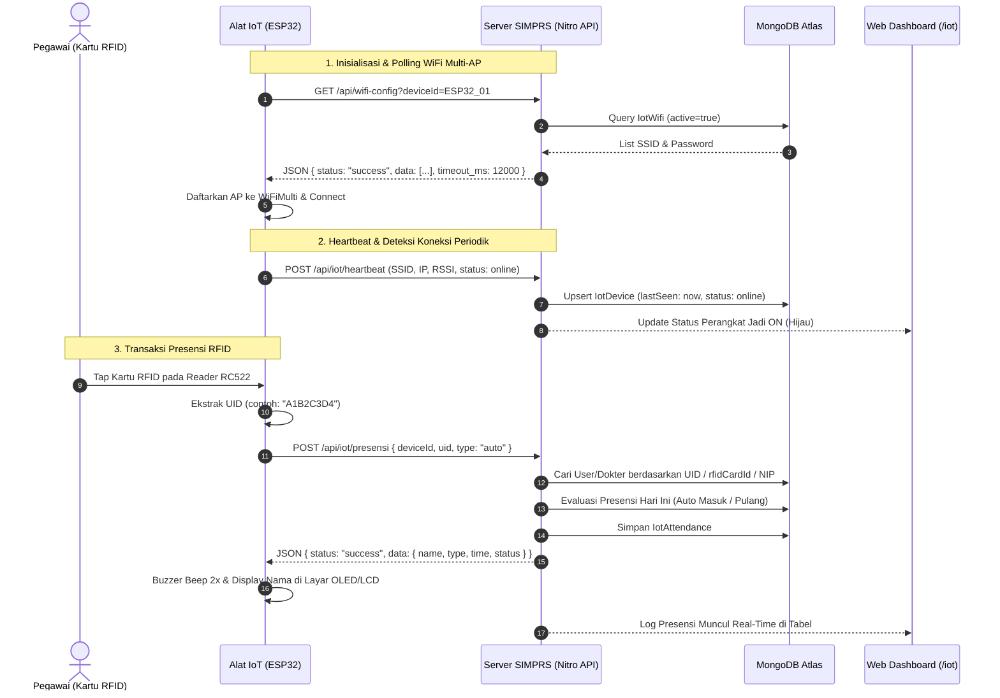

# Dokumentasi Modul Presensi & Perangkat IoT (Internet of Things)

> **e-Health SIMPRS** · Modul Integrasi Hardware Arduino / ESP32  
> **Kompatibilitas:** ArduinoJson v7.x · WiFiMulti · ESP32 / ESP8266 · RFID RC522 / PN532 · REST API JSON

---

## Daftar Isi

1. [Gambaran Umum](#1-gambaran-umum)
2. [Arsitektur Sistem & Alur Komunikasi](#2-arsitektur-sistem--alur-komunikasi)
3. [Skema Database (MongoDB / Mongoose)](#3-skema-database-mongodb--mongoose)
4. [Spesifikasi REST API](#4-spesifikasi-rest-api)
   - [A. Polling Konfigurasi WiFi (`GET /api/wifi-config`)](#a-polling-konfigurasi-wifi-get-apiwifi-config)
   - [B. Lapor Status & Heartbeat (`POST /api/iot/heartbeat`)](#b-lapor-status--heartbeat-post-apiiotheartbeat)
   - [C. Pencatatan Presensi Tap Kartu (`POST /api/iot/presensi`)](#c-pencatatan-presensi-tap-kartu-post-apiiotpresensi)
   - [D. Endpoint Manajemen Dashboard Web](#d-endpoint-manajemen-dashboard-web)
5. [Keamanan & Mekanisme Bypass Autentikasi](#5-keamanan--mekanisme-bypass-autentikasi)
6. [Halaman Dashboard IoT (`/iot`)](#6-halaman-dashboard-iot-iot)
7. [Sketsa Lengkap Firmware Arduino / ESP32 (ArduinoJson v7)](#7-sketsa-lengkap-firmware-arduino--esp32-arduinojson-v7)
8. [Panduan Pengujian & Troubleshooting](#8-panduan-pengujian--troubleshooting)

---

## 1. Gambaran Umum

Modul **Presensi & Perangkat IoT** di e-Health SIMPRS dirancang untuk menghubungkan mesin presensi fisik berbasis mikrokontroler (ESP32 / ESP8266 / Arduino) dengan sistem inti rumah sakit secara otomatis, nirkabel, dan real-time.

### Fitur Utama:
- **Multi-AP WiFi Pooling:** Perangkat IoT tidak perlu di-*hardcode* password WiFi-nya. Perangkat melakukan pooling ke endpoint server untuk mengambil daftar kredensial WiFi cadangan (*failover*) jika jaringan utama terputus. Format JSON disesuaikan langsung untuk **ArduinoJson v7**.
- **Monitoring Status Device Real-Time (ON / OFF):** Server mendeteksi apakah mesin presensi sedang menyala atau mati berdasarkan batas toleransi waktu *heartbeat* (2 menit).
- **Deteksi Konektivitas WiFi Perangkat:** Sistem mengetahui secara pasti SSID WiFi mana yang sedang digunakan oleh mesin presensi, beserta IP Address lokal dan kekuatan sinyal (*RSSI*).
- **Presensi Masuk & Pulang Otomatis:** Perangkat membaca UID kartu RFID / NIP pegawai, mengirimkannya ke server, dan server otomatis menentukan status kehadiran (Masuk/Pulang, Tepat Waktu/Terlambat/Pulang Cepat).
- **Notifikasi Real-time & Simulator:** Dilengkapi fitur simulasi tap kartu langsung dari browser untuk kemudahan *testing* tanpa alat fisik.

---

## 2. Arsitektur Sistem & Alur Komunikasi



---

## 3. Skema Database (MongoDB / Mongoose)

Sistem menggunakan 3 koleksi MongoDB khusus yang terintegrasi dengan koleksi pengguna yang sudah ada:

### 1. `IotWifi` (`server/models/IotWifi.ts`)
Menyimpan kredensial WiFi yang akan disebarkan ke perangkat IoT saat pooling:
```typescript
{
  ssid: string;          // Nama SSID WiFi (wajib)
  password: string;      // Password WiFi (wajib, dapat dilihat admin di UI)
  priority: number;      // Urutan prioritas koneksi (1, 2, 3...)
  isActive: boolean;      // Status aktif (true / false)
  description?: string;  // Lokasi/catatan AP (contoh: "Ruang Front Office Lantai 1")
  timeoutMs: number;     // Timeout percobaan koneksi mikrokontroler (default: 12000 ms)
  createdAt: Date;
  updatedAt: Date;
}
```

### 2. `IotDevice` (`server/models/IotDevice.ts`)
Mencatat identitas hardware dan status live mesin presensi:
```typescript
{
  deviceId: string;          // ID unik alat (contoh: "ESP32_ATTENDANCE_01")
  name: string;              // Nama alias alat (contoh: "Mesin Presensi Pintu Masuk")
  location?: string;         // Lokasi fisik pemasangan
  status: 'online'|'offline';// Status terakhir
  lastSeen: Date;            // Waktu timestamp kontak terakhir dari perangkat
  connectedSsid?: string;    // SSID WiFi yang saat ini terhubung ke alat
  ipAddress?: string;        // IP lokal perangkat (contoh: "192.168.1.105")
  rssi?: number;             // Kekuatan sinyal Wi-Fi dalam dBm (contoh: -65)
  firmwareVersion?: string;  // Versi firmware alat (contoh: "v1.0.0")
  isActive: boolean;
  notes?: string;
}
```

### 3. `IotAttendance` (`server/models/IotAttendance.ts`)
Menyimpan setiap riwayat transaksi tap kartu kehadiran:
```typescript
{
  deviceId: string;                          // Device pengirim presensi
  deviceName?: string;                       // Nama alat saat presensi
  uid: string;                               // UID kartu RFID atau nomor NIP
  user?: ObjectId;                           // Relasi ke User (opsional jika terdaftar)
  userName: string;                          // Nama pegawai atau "Kartu Tamu (UID)"
  userNip?: string;                          // NIP pegawai
  userRole?: string;                         // Role pegawai (doctor, nurse, admin, dll.)
  type: 'masuk' | 'pulang';                  // Tipe presensi
  timestamp: Date;                           // Waktu presensi dicatat
  status: 'tepat_waktu' | 'terlambat' | 'pulang_cepat' | 'lembur';
  connectedSsid?: string;                    // WiFi yang digunakan alat saat tapping
  notes?: string;                            // Catatan / status otentikasi
}
```

### 4. Ekstensi `User` (`server/models/User.ts`)
Ditambahkan field:
```typescript
rfidCardId: { type: String, trim: true, sparse: true, index: true }
```
Sehingga admin dapat langsung memasukkan UID kartu RFID fisik ke profil pegawai.

---

## 4. Spesifikasi REST API

### A. Polling Konfigurasi WiFi (`GET /api/wifi-config`)

Endpoint utama yang dipanggil oleh ESP32 untuk mengambil daftar SSID & password cadangan.

- **Method:** `GET`
- **URL:** `/api/wifi-config`
- **Autentikasi:** Publik / Bebas (Tidak memerlukan session cookie).
- **Query Parameter (Opsional untuk sekalian update telemetry):**
  - `deviceId`: String ID alat (contoh: `ESP32_ATTENDANCE_01`)
  - `connected_ssid`: String SSID yang sedang tersambung saat polling
  - `ip`: IP Address alat
  - `rssi`: Nilai sinyal dalam dBm

#### Response Sukses (Format Standar ArduinoJson v7):
```json
{
  "status": "success",
  "data": [
    {
      "ssid": "Kantor_Utama",
      "password": "passwordUtama123"
    },
    {
      "ssid": "Kantor_Cadangan",
      "password": "passwordCadangan456"
    },
    {
      "ssid": "Hotspot_Maintenance",
      "password": "bembietigaduasatu"
    }
  ],
  "timeout_ms": 12000
}
```

---

### B. Lapor Status & Heartbeat (`POST /api/iot/heartbeat`)

Dipanggil secara periodik oleh alat untuk mengonfirmasi bahwa alat dalam kondisi **ON** dan melaporkan jaringan WiFi aktif.

- **Method:** `POST`
- **URL:** `/api/iot/heartbeat` *(alias: `/api/iot/device-status`)*
- **Header:** `Content-Type: application/json`
- **Autentikasi:** Publik.

#### Request Body:
```json
{
  "deviceId": "ESP32_ATTENDANCE_01",
  "deviceName": "Mesin Presensi Lobi Utama",
  "status": "online",
  "connectedSsid": "Kantor_Utama",
  "ipAddress": "192.168.1.105",
  "rssi": -65,
  "location": "Lobi Utama",
  "firmwareVersion": "1.0.0"
}
```

#### Response Sukses:
```json
{
  "status": "success",
  "message": "Heartbeat & status WiFi perangkat berhasil dicatat",
  "serverTime": "2026-11-01T15:35:00.000Z",
  "device": {
    "deviceId": "ESP32_ATTENDANCE_01",
    "name": "Mesin Presensi Lobi Utama",
    "status": "online",
    "connectedSsid": "Kantor_Utama",
    "ipAddress": "192.168.1.105",
    "rssi": -65,
    "lastSeen": "2026-11-01T15:35:00.000Z"
  }
}
```

---

### C. Pencatatan Presensi Tap Kartu (`POST /api/iot/presensi`)

Dipanggil seketika saat sensor RFID mendeteksi kartu pegawai.

- **Method:** `POST`
- **URL:** `/api/iot/presensi`
- **Header:** `Content-Type: application/json`
- **Autentikasi:** Publik.

#### Request Body:
```json
{
  "deviceId": "ESP32_ATTENDANCE_01",
  "uid": "A1B2C3D4",
  "type": "auto",
  "connectedSsid": "Kantor_Utama"
}
```

| Field | Tipe | Keterangan |
| :--- | :--- | :--- |
| `deviceId` | `string` | ID perangkat yang membaca kartu (Wajib). |
| `uid` | `string` | UID fisik kartu RFID atau NIP pegawai (Wajib). |
| `type` | `string` | `"auto"` (otomatis deteksi masuk/pulang), `"masuk"`, atau `"pulang"`. |
| `connectedSsid`| `string` | Nama SSID WiFi yang sedang aktif saat transaksi. |

#### Logika Evaluasi Otomatis (`type = "auto"`):
1. Sistem memeriksa riwayat presensi hari ini untuk pegawai bersangkutan.
2. Jika **belum ada** presensi hari ini $\rightarrow$ Tipe diset menjadi **`masuk`**.
3. Jika presensi terakhir hari ini adalah `masuk` $\rightarrow$ Tipe diset menjadi **`pulang`**.
4. Ketepatan waktu:
   - **Masuk:** Jika tap dilakukan $> 08:00\text{ WIB} \rightarrow$ **`terlambat`**, selain itu **`tepat_waktu`**.
   - **Pulang:** Jika tap dilakukan $< 17:00\text{ WIB} \rightarrow$ **`pulang_cepat`**, jika $\ge 19:00\text{ WIB} \rightarrow$ **`lembur`**.

#### Response Sukses (Ideal untuk Display LCD / OLED):
```json
{
  "status": "success",
  "message": "Presensi masuk berhasil dicatat",
  "data": {
    "id": "6724da1c5...",
    "uid": "A1B2C3D4",
    "name": "dr. Budi Santoso",
    "nip": "198501012010011001",
    "role": "doctor",
    "type": "masuk",
    "status": "tepat_waktu",
    "time": "07:45:12",
    "date": "2026-11-01",
    "deviceId": "ESP32_ATTENDANCE_01",
    "connectedSsid": "Kantor_Utama"
  }
}
```

---

### D. Endpoint Sinkronisasi & Perubahan Nama Perangkat (`POST /api/iot/device-name`)

Endpoint publik yang memungkinkan perangkat mikrokontroler (Arduino/ESP32) untuk menyinkronkan atau mengubah nama perangkat langsung dari hardware, atau menerima nama yang sudah diubah oleh admin di web dashboard.

- **Method:** `POST`
- **URL:** `/api/iot/device-name`
- **Header:** `Content-Type: application/json`
- **Autentikasi:** Publik.

#### Request Body:
```json
{
  "deviceId": "ESP32_ATTENDANCE_01",
  "name": "Mesin Presensi Poli Bedah",
  "location": "Lantai 2 - Poli Bedah"
}
```

#### Response Sukses:
```json
{
  "status": "success",
  "message": "Data perangkat berhasil disinkronkan",
  "device": {
    "deviceId": "ESP32_ATTENDANCE_01",
    "name": "Mesin Presensi Poli Bedah",
    "location": "Lantai 2 - Poli Bedah",
    "status": "online",
    "connectedSsid": "Kantor_Utama",
    "lastSeen": "2026-11-01T16:00:00.000Z"
  }
}
```

---

### D. Telemetri Sensor IoT Lingkungan & Medis (`POST /api/iot/sensor/telemetry`)

Endpoint ini digunakan oleh perangkat mikrokontroler (ESP32 / Arduino / Raspberry Pi Pico W) yang berfungsi sebagai **Sensor IoT** (pemantauan suhu ruangan obat/vaksin, kelembaban, tetesan infus, tekanan gas medis, dll.).

- **Method:** `POST`
- **URL:** `/api/iot/sensor/telemetry`
- **Headers:** `Content-Type: application/json`
- **Akses:** Bebas autentikasi (Whitelisted untuk IoT hardware)

#### Format Request Body JSON:
```json
{
  "deviceId": "ESP32_SENSOR_FARMASI_01",
  "values": {
    "temperature": 24.5,
    "humidity": 60.2
  },
  "connected_ssid": "Kantor_Utama",
  "ip": "192.168.1.106",
  "rssi": -62
}
```

#### Format Respon JSON (ArduinoJson v7 Compatible):
```json
{
  "status": "success",
  "message": "Telemetry received successfully",
  "device_id": "ESP32_SENSOR_FARMASI_01",
  "device_name": "Sensor Suhu Ruang Farmasi",
  "condition": "normal",
  "alert": null,
  "values": {
    "temperature": 24.5,
    "humidity": 60.2
  },
  "server_time": 1730452930
}
```

> **Fitur Evaluasi Threshold Otomatis:**  
> Jika nilai telemetri melampaui `maxThreshold` atau `minThreshold` yang dikonfigurasi pada perangkat, server akan mengembalikan `condition: "warning"` atau `"danger"`, menyertakan pesan detail di field `alert`, dan otomatis memicu notifikasi peringatan (*in-app notification*) ke peran dokter/perawat/admin!

---

### E. Endpoint Manajemen Dashboard Web (Lengkap dengan Request & Response JSON)

Endpoint di bawah ini digunakan oleh antarmuka dashboard web dan dilindungi autentikasi session NextAuth & hak akses RBAC (`role: admin`, `doctor`, `nurse`, `receptionist`):

#### 1. Ubah / Edit Nama & Lokasi Perangkat (`PUT /api/iot/devices/:id`)
- **Method:** `PUT`
- **URL:** `/api/iot/devices/:id` (dapat berupa MongoDB `_id` atau `deviceId` seperti `ESP32_ATTENDANCE_01`)
- **Request Body:**
```json
{
  "name": "Mesin Presensi Poli Jantung",
  "location": "Lantai 1 - Poli Jantung",
  "notes": "Modul ESP32 + RFID RC522",
  "isActive": true
}
```
- **Response Sukses:**
```json
{
  "data": {
    "_id": "6724da1c51a...",
    "deviceId": "ESP32_ATTENDANCE_01",
    "name": "Mesin Presensi Poli Jantung",
    "location": "Lantai 1 - Poli Jantung",
    "status": "online",
    "isActive": true
  }
}
```

#### 2. Dapatkan Daftar Perangkat & Status Live (`GET /api/iot/devices`)
- **Method:** `GET`
- **URL:** `/api/iot/devices`
- **Response Sukses:**
```json
{
  "data": {
    "devices": [
      {
        "_id": "6724da...",
        "deviceId": "ESP32_ATTENDANCE_01",
        "name": "Mesin Presensi Poli Jantung",
        "location": "Lantai 1 - Poli Jantung",
        "status": "online",
        "computedStatus": "online",
        "lastSeen": "2026-11-01T15:58:30.000Z",
        "lastSeenSecondsAgo": 35,
        "connectedSsid": "Kantor_Utama",
        "ipAddress": "192.168.1.105",
        "rssi": -65
      }
    ],
    "stats": {
      "total": 1,
      "online": 1,
      "offline": 0
    }
  }
}
```

#### 3. Tambah Perangkat Baru Manual (`POST /api/iot/devices`)
- **Method:** `POST`
- **URL:** `/api/iot/devices`
- **Request Body:**
```json
{
  "deviceId": "ESP32_ATTENDANCE_02",
  "name": "Mesin Presensi Farmasi",
  "location": "Depan Apotek Rawat Jalan",
  "notes": "Perangkat cadangan"
}
```

#### 4. Hapus Perangkat (`DELETE /api/iot/devices/:id`)
- **Method:** `DELETE`
- **URL:** `/api/iot/devices/:id`
- **Response:** `{ "data": { "message": "Perangkat berhasil dihapus" } }`

#### 5. Uji Ping Simulasi Perangkat (`POST /api/iot/devices/:id/ping`)
- **Method:** `POST`
- **URL:** `/api/iot/devices/:id/ping`
- **Response:**
```json
{
  "data": {
    "message": "Simulasi ping perangkat Mesin Presensi (ESP32_ATTENDANCE_01) berhasil",
    "device": { "status": "online", "lastSeen": "2026-11-01T16:01:00.000Z" }
  }
}
```

#### 6. Dapatkan Daftar WiFi & Deteksi Terhubung (`GET /api/iot/wifi`)
- **Method:** `GET`
- **URL:** `/api/iot/wifi`
- **Response Sukses:**
```json
{
  "data": {
    "wifis": [
      {
        "_id": "6724f...",
        "ssid": "Kantor_Utama",
        "password": "passwordUtama123",
        "priority": 1,
        "isActive": true,
        "description": "Jaringan Utama Kantor & Poli",
        "timeoutMs": 12000,
        "connectedCount": 1,
        "connectedDevices": [
          {
            "deviceId": "ESP32_ATTENDANCE_01",
            "name": "Mesin Presensi Poli Jantung",
            "ipAddress": "192.168.1.105",
            "rssi": -65
          }
        ]
      }
    ],
    "timeout_ms": 12000,
    "totalActive": 1,
    "totalAll": 3
  }
}
```

#### 7. Tambah Konfigurasi WiFi Baru (`POST /api/iot/wifi`)
- **Method:** `POST`
- **URL:** `/api/iot/wifi`
- **Request Body:**
```json
{
  "ssid": "WiFi_Dokter_Spesialis",
  "password": "dokterHealSecure2026",
  "priority": 4,
  "isActive": true,
  "description": "Access Point Khusus Ruang Dokter",
  "timeoutMs": 12000
}
```

#### 8. Edit Konfigurasi WiFi (`PUT /api/iot/wifi/:id`)
- **Method:** `PUT`
- **URL:** `/api/iot/wifi/:id`
- **Request Body:**
```json
{
  "ssid": "WiFi_Dokter_Spesialis",
  "password": "passwordBaru789",
  "priority": 2,
  "isActive": true,
  "description": "Update password baru"
}
```

#### 9. Hapus Konfigurasi WiFi (`DELETE /api/iot/wifi/:id`)
- **Method:** `DELETE`
- **URL:** `/api/iot/wifi/:id`

#### 10. Ambil Log Presensi (`GET /api/iot/attendance`)
- **Method:** `GET`
- **URL:** `/api/iot/attendance?page=1&pageSize=15&type=all&status=all&search=budi`
- **Response Sukses:**
```json
{
  "data": {
    "items": [
      {
        "_id": "6724fa...",
        "deviceId": "ESP32_ATTENDANCE_01",
        "deviceName": "Mesin Presensi Poli Jantung",
        "uid": "A1B2C3D4",
        "userName": "dr. Budi Santoso",
        "userNip": "198501012010011001",
        "userRole": "doctor",
        "type": "masuk",
        "status": "tepat_waktu",
        "connectedSsid": "Kantor_Utama",
        "timestamp": "2026-11-01T07:45:12.000Z"
      }
    ],
    "stats": {
      "todayTotal": 14,
      "todayMasuk": 10,
      "todayPulang": 4,
      "todayTerlambat": 2
    }
  },
  "meta": {
    "total": 1,
    "page": 1,
    "pageSize": 15,
    "totalPages": 1
  }
}
```

#### 11. Catat Presensi Manual dari Web (`POST /api/iot/attendance`)
- **Method:** `POST`
- **URL:** `/api/iot/attendance`
- **Request Body:**
```json
{
  "userId": "6645a7b8c...",
  "type": "masuk",
  "status": "tepat_waktu",
  "notes": "Kartu RFID tertinggal di rumah"
}
```

#### 12. Dapatkan Daftar Staf & Dokter untuk Dropdown (`GET /api/iot/staff`)
- **Method:** `GET`
- **URL:** `/api/iot/staff`
- **Response Sukses:**
```json
{
  "data": [
    {
      "id": "6645a7...",
      "name": "dr. Budi Santoso",
      "nip": "198501012010011001",
      "role": "doctor",
      "department": "Poli Jantung",
      "rfidCardId": "A1B2C3D4",
      "type": "user"
    }
  ]
}
```

---

## 5. Keamanan & Mekanisme Bypass Autentikasi

Pada arsitektur Nuxt 3 e-Health, semua endpoint di bawah `/api/*` secara bawaan dilindungi oleh middleware [`server/middleware/auth.ts`](file:///Users/herlambangk/FileKu/Bermain/e-Health/server/middleware/auth.ts).

Agar mikrokontroler Arduino/ESP32 dapat berkomunikasi tanpa cookies sesi browser, rute-rute khusus IoT telah dikecualikan:

```typescript
// server/middleware/auth.ts
const isIotDeviceEndpoint =
  pathname === '/api/wifi-config' ||
  pathname.startsWith('/api/wifi-config') ||
  pathname === '/api/iot/presensi' ||
  pathname === '/api/iot/heartbeat' ||
  pathname === '/api/iot/device-status' ||
  pathname === '/api/iot/ping';

if (isIotDeviceEndpoint) {
  return; // Loloskan request tanpa pemeriksaan cookie sesi
}
```

Sementara itu, endpoint manajemen CRUD diakses melalui browser dengan otorisasi RBAC menggunakan resource `'iot'`:
- **`admin`**: Memiliki hak `allActions` (`create`, `read`, `update`, `delete`).
- **`doctor`**, **`nurse`**: Memiliki hak `read`.
- **`receptionist`**: Memiliki hak `read`, `create`.
- **`patient`**, **`billing`**: Ditolak (`forbidden`).

---

## 6. Halaman Dashboard IoT (`/iot`)

Akses halaman: **`http://localhost:3000/iot`**

Tampilan dirancang menggunakan komponen **Nuxt UI** dengan tema responsif:

1. **Ringkasan Metrik (Header Cards):**
   - Kartu 1: Status Perangkat (Total Unit, Jumlah Online dengan indikator berdenyut hijau, Jumlah Offline).
   - Kartu 2: Presensi Masuk Hari Ini & Jumlah Terlambat.
   - Kartu 3: Presensi Pulang Hari Ini & Total Transaksi Tap.
   - Kartu 4: WiFi Multi-AP Pool (Jumlah SSID aktif & Timeout pool).
2. **Tab 1: Status & Monitoring Perangkat (ON / OFF):**
   - Menampilkan card grid setiap mesin presensi.
   - Indikator badge `ONLINE (ON)` jika perangkat aktif dalam 2 menit terakhir.
   - Menampilkan SSID WiFi terhubung, IP lokal, dan RSSI dBm sinyal.
   - Tombol **Simulasi Ping** untuk menguji respon alat.
3. **Tab 2: Tabel Presensi Masuk & Pulang:**
   - Filter cepat (Hari ini, 7 hari, 30 hari, semua).
   - Filter tipe presensi (Masuk / Pulang) dan status ketepatan waktu.
   - Pencarian real-time nama pegawai, NIP, UID kartu.
   - Kolom menampilkan nama alat IoT dan SSID WiFi yang dipakai saat tap kartu.
4. **Tab 3: Konfigurasi WiFi Multi-AP:**
   - Tabel SSID dan Password tersimpan.
   - Tombol intip password (ikon mata 👁️) dan salin ke clipboard.
   - Deteksi otomatis: Jika ada mesin presensi yang sedang menggunakan SSID tersebut, akan muncul badge hijau `Terhubung ke [Nama Device]`.
   - Tombol **Lihat Output JSON** untuk memverifikasi struktur output `/api/wifi-config`.
5. **Tab 4: Panduan & Kode Arduino:**
   - Referensi sintaksis library **ArduinoJson v7**.
   - Contoh kode C++ siap pakai yang dapat disalin dengan satu klik.

---

## 7. Sketsa Lengkap Firmware Arduino / ESP32 (ArduinoJson v7)

Berikut adalah kode firmware produksi untuk board ESP32 yang menggunakan library bawaan `WiFiMulti` dan `ArduinoJson v7`:

```cpp
/*
  ==============================================================
  SKETSA ARDUINO / ESP32: PRESENSI IOT SIMPRS MULTI-AP WIFI POOL
  Library Pendukung:
    - ArduinoJson v7.x (Benoit Blanchon)
    - MFRC522 (Miguel Balboa) untuk RFID Reader
    - WiFi & HTTPClient (Bawaan ESP32 Core)
  ==============================================================
*/

#include <WiFi.h>
#include <WiFiMulti.h>
#include <HTTPClient.h>
#include <ArduinoJson.h>
#include <SPI.h>
#include <MFRC522.h>

// Definisi Pin Hardware
#define RST_PIN   22
#define SS_PIN    21
#define BUZZER    4

// Konfigurasi Perangkat & Server
const char* DEVICE_ID   = "ESP32_ATTENDANCE_01";
const char* BASE_SERVER = "http://192.168.1.10:3000"; // Ganti dengan IP host server e-Health

WiFiMulti wifiMulti;
MFRC522 rfid(SS_PIN, RST_PIN);

unsigned long lastHeartbeat = 0;
const unsigned long HEARTBEAT_INTERVAL = 30000; // Kirim detak status setiap 30 detik

// -------------------------------------------------------------
// 1. FUNGSI POOLING KONFIGURASI WIFI DARI SERVER
// -------------------------------------------------------------
void fetchAndConfigureWifi() {
  Serial.println("[WIFI] Meminta daftar WiFi pool dari server...");
  HTTPClient http;
  String url = String(BASE_SERVER) + "/api/wifi-config?deviceId=" + DEVICE_ID;
  http.begin(url);
  int httpCode = http.GET();

  if (httpCode == HTTP_CODE_OK) {
    String payload = http.getString();
    Serial.println("[WIFI] Payload diterima:");
    Serial.println(payload);

    // Parsing JSON dengan sintaks ArduinoJson v7
    JsonDocument doc;
    DeserializationError error = deserializeJson(doc, payload);

    if (!error && doc["status"] == "success") {
      JsonArray wifiList = doc["data"].as<JsonArray>();
      for (JsonObject item : wifiList) {
        const char* ssid = item["ssid"];
        const char* pass = item["password"];
        wifiMulti.addAP(ssid, pass);
        Serial.printf("[WIFI] Mendaftarkan AP: %s\n", ssid);
      }
    } else {
      Serial.println("[ERR] Gagal parsing JSON konfigurasi WiFi!");
    }
  } else {
    Serial.printf("[ERR] HTTP GET gagal, kode: %d\n", httpCode);
  }
  http.end();
}

// -------------------------------------------------------------
// 2. FUNGSI LAPOR STATUS & HEARTBEAT (DETEKSI WIFI TERHUBUNG)
// -------------------------------------------------------------
void sendHeartbeat() {
  if (WiFi.status() != WL_CONNECTED) return;

  HTTPClient http;
  String url = String(BASE_SERVER) + "/api/iot/heartbeat";
  http.begin(url);
  http.addHeader("Content-Type", "application/json");

  JsonDocument doc;
  doc["deviceId"]      = DEVICE_ID;
  doc["deviceName"]    = "Mesin Presensi Lobi Utama";
  doc["status"]        = "online";
  doc["connectedSsid"] = WiFi.SSID();
  doc["ipAddress"]     = WiFi.localIP().toString();
  doc["rssi"]          = WiFi.RSSI();

  String requestBody;
  serializeJson(doc, requestBody);

  int httpCode = http.POST(requestBody);
  if (httpCode == HTTP_CODE_OK) {
    Serial.println("[HEARTBEAT] Sukses dikirim. Sinyal: " + String(WiFi.RSSI()) + " dBm");
  }
  http.end();
}

// -------------------------------------------------------------
// 3. FUNGSI MENCATAT PRESENSI TAP KARTU RFID
// -------------------------------------------------------------
void sendAttendance(String uid) {
  if (WiFi.status() != WL_CONNECTED) {
    Serial.println("[ERR] WiFi terputus! Presensi dibatalkan.");
    return;
  }

  HTTPClient http;
  String url = String(BASE_SERVER) + "/api/iot/presensi";
  http.begin(url);
  http.addHeader("Content-Type", "application/json");

  JsonDocument doc;
  doc["deviceId"]      = DEVICE_ID;
  doc["uid"]           = uid;
  doc["type"]          = "auto"; // Otomatis deteksi Masuk / Pulang
  doc["connectedSsid"] = WiFi.SSID();

  String requestBody;
  serializeJson(doc, requestBody);

  int httpCode = http.POST(requestBody);
  if (httpCode == HTTP_CODE_OK) {
    String response = http.getString();
    JsonDocument resDoc;
    deserializeJson(resDoc, response);

    const char* nama = resDoc["data"]["name"];
    const char* tipe = resDoc["data"]["type"];
    const char* jam  = resDoc["data"]["time"];
    const char* stat = resDoc["data"]["status"];

    Serial.printf("[BERHASIL] %s (%s) pukul %s [%s]\n", nama, tipe, jam, stat);

    // Nada Beep Sukses (2x bip pendek)
    tone(BUZZER, 2000, 120);
    delay(150);
    tone(BUZZER, 2000, 120);
  } else {
    Serial.printf("[ERR] Gagal mencatat presensi, HTTP: %d\n", httpCode);
    // Nada Beep Gagal (1x bip panjang)
    tone(BUZZER, 800, 500);
  }
  http.end();
}

// -------------------------------------------------------------
// SETUP & LOOP UTAMA
// -------------------------------------------------------------
void setup() {
  Serial.begin(115200);
  pinMode(BUZZER, OUTPUT);
  SPI.begin();
  rfid.PCD_Init();

  Serial.println("\n[BOOT] Inisialisasi Perangkat IoT Presensi...");

  // Hubungkan ke AP default awal untuk mengambil konfigurasi server
  WiFi.begin("Kantor_Utama", "passwordUtama123");
  int retry = 0;
  while (WiFi.status() != WL_CONNECTED && retry < 20) {
    delay(500);
    Serial.print(".");
    retry++;
  }

  // Tarik data konfigurasi pool WiFi multi-AP
  fetchAndConfigureWifi();

  // Kirim status awal bahwa perangkat sudah ON
  sendHeartbeat();

  Serial.println("\n[SIAP] Silakan tap kartu RFID Anda!");
}

void loop() {
  // 1. Otomatis hubungkan ke AP terkuat/tersedia
  if (wifiMulti.run() != WL_CONNECTED) {
    Serial.println("[WIFI] Mencari jaringan WiFi yang terdaftar...");
    delay(1000);
    return;
  }

  // 2. Kirim heartbeat berkala untuk menjaga status ON
  if (millis() - lastHeartbeat > HEARTBEAT_INTERVAL) {
    lastHeartbeat = millis();
    sendHeartbeat();
  }

  // 3. Deteksi kartu RFID
  if (!rfid.PICC_IsNewCardPresent() || !rfid.PICC_ReadCardSerial()) {
    delay(50);
    return;
  }

  // Konversi byte UID ke string Hexadecimal
  String uidStr = "";
  for (byte i = 0; i < rfid.uid.size; i++) {
    uidStr += String(rfid.uid.uidByte[i] < 0x10 ? "0" : "");
    uidStr += String(rfid.uid.uidByte[i], HEX);
  }
  uidStr.toUpperCase();
  Serial.println("[RFID] Kartu terdeteksi UID: " + uidStr);

  // Kirim ke server SIMPRS
  sendAttendance(uidStr);

  rfid.PICC_HaltA();
  delay(1200); // Debounce tapping
}
```

---

## 8. Panduan Pengujian & Troubleshooting

### Menguji Tanpa Alat Fisik (Simulasi Browser):
1. Buka browser dan login sebagai Admin pada `http://localhost:3000`.
2. Klik menu **Presensi IoT** di sidebar atau akses langsung `/iot`.
3. Klik tombol **Simulasi Tap RFID** di kanan atas.
4. Pilih ID perangkat dan masukkan UID (misal nomor NIP pegawai atau kode kartu `A1B2C3D4`).
5. Klik **Kirim Simulasi Tap**.
6. Periksa hasilnya:
   - Respon server dengan format JSON ArduinoJson v7 akan muncul pada dialog.
   - Rekam kehadiran langsung muncul pada **Tabel Presensi Masuk & Pulang**.
   - Status perangkat yang bersangkutan otomatis berubah menjadi **ONLINE (ON)** dengan lampu hijau menyala.

### Troubleshooting:
- **Perangkat Terdeteksi OFFLINE:**
  - Status OFFLINE diberikan jika perangkat tidak mengirimkan data lebih dari 2 menit (120 detik). Pastikan timer `HEARTBEAT_INTERVAL` pada Arduino diset antara 30-60 detik.
- **Kartu Tamu / Baru:**
  - Jika UID yang di-tap belum didaftarkan pada profil pegawai/dokter manapun, sistem tetap menyimpan log presensi dengan nama `Kartu Tamu / Baru (UID)`. Admin dapat mencatat UID tersebut lalu menyimpannya pada field `rfidCardId` profil pegawai di `/profile` atau database.
- **WiFi Tidak Terkoneksi:**
  - Pastikan frekuensi WiFi adalah **2.4 GHz**, karena modul ESP8266 dan sebagian besar varian ESP32 standar tidak mendukung frekuensi 5 GHz.

